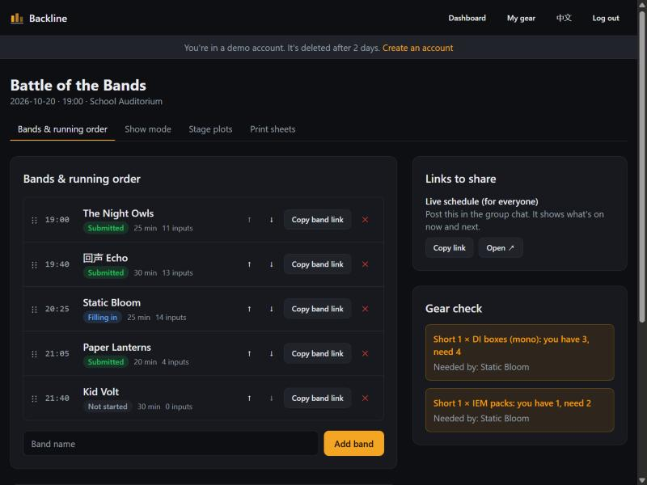
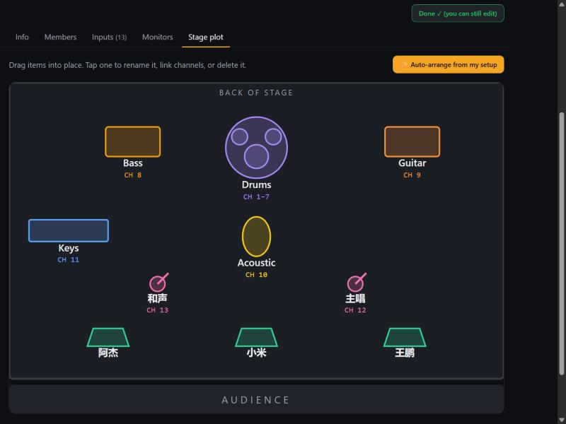
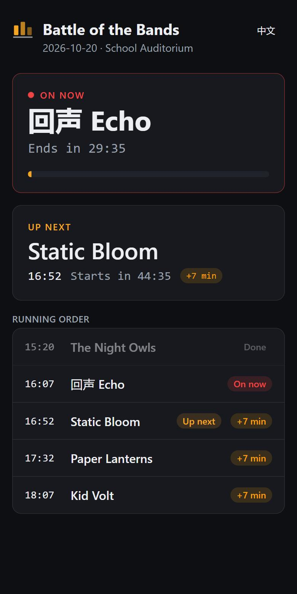
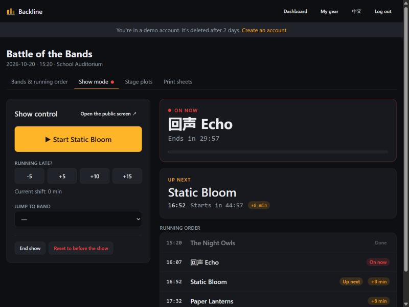

# Backline

[](https://github.com/Tarmk/backline/actions/workflows/ci.yml)


**Run your gig night from one link.**

**Live demo:** https://backline-nine-delta.vercel.app (click **Try the demo**, no sign-up)

**Live demo: [backline-nine-delta.vercel.app](https://backline-nine-delta.vercel.app)** (click *Try the demo*, no sign-up)

[](https://github.com/Tarmk/backline/actions/workflows/ci.yml)

Bands send their setup through a private link: members, input list, monitor mixes and a drag-and-drop stage plot. The organiser gets a gear check, printable input lists and a running order. On the night, everyone's phone shows what's on now, what's next, and how late things are running.

Built for multi-band nights like Battle of the Bands, where the "system" is usually a group chat, a spreadsheet and someone shouting across the stage. Works in **English and 中文**, and doesn't depend on services that are blocked in mainland China.



## Features

| | |
|---|---|
| **One link per band** | No accounts for bands. They open the link on their phone and fill in the form, and it autosaves. |
| **Input list builder** | One-tap presets (full drum kit, vocals, DIs…) in English or Chinese, reorderable channels. |
| **Gear check** | Compares what each band needs with the venue's gear and shows shortages *and which band causes them*. Bands play one at a time, so it checks the peak, not the total. |
| **Stage plots** | Auto-arranged from the input list, then drag to adjust. Every item shows its channel numbers. |
| **Changeover view** | Each band's stage plot next to the next band's, so the crew knows what moves. |
| **Live show mode** | Start a band and every later slot re-times from the real start. "+10 min" shifts everyone at once. Phones poll every few seconds and recover on their own after Wi-Fi dropouts. |
| **Print sheets** | Running order plus a page per band: input list, monitors, stage plot. |
| **Demo mode** | One click creates a throwaway account with a realistic five-band event. |

<p>
  
  
</p>



## Tech

- **Next.js 16** (App Router, Server Actions) + **React 19** + **TypeScript**
- **Tailwind CSS 4**, system fonts only (fast, and nothing blocked in China)
- **PostgreSQL** via **Drizzle ORM**. Locally it runs **PGlite** (Postgres compiled to WebAssembly), so there's nothing to install. In production it uses a normal Postgres server with the same SQL migrations.
- **Vitest**: unit tests for scheduling, gear and stage-plot logic, plus integration tests against an in-memory Postgres
- **GitHub Actions** CI: lint → typecheck → tests → build
- **Docker Compose** deploy with Caddy for automatic HTTPS

### Design decisions

- **Polling instead of websockets for live updates.** Phones fetch a small JSON snapshot every 4 seconds. It works behind any host or proxy and recovers by itself after venue Wi-Fi drops out, and at gig scale (tens of phones) the load is trivial. Countdowns are corrected for each phone's clock skew using the server's time.
- **The schedule is computed, not stored.** Only the plan (start time, set lengths, changeover) and three bits of live state (which band is on, when it really started, a manual delay) are saved. Every displayed time is derived by one pure, tested function, so nothing can drift out of sync.
- **Bands are authorised by an unguessable link token**, organisers by a session cookie. Session tokens are stored hashed. Passwords use scrypt from Node's standard library.
- **Timezones are explicit.** Events store the venue's local date and time plus an IANA timezone, and conversion uses `Intl` with no date library.

## Run it locally

Needs Node.js 20+ and pnpm.

```bash
pnpm install
pnpm dev
```

Open http://localhost:3000 and click **Try the demo**. Data is stored in `.data/` (git-ignored).

```bash
pnpm test        # unit + integration tests
pnpm lint
pnpm typecheck
pnpm build
```

## Deploy

See [docs/DEPLOY.md](docs/DEPLOY.md). Short version: on any Linux server with Docker,

```bash
cp .env.example .env   # set DOMAIN and POSTGRES_PASSWORD
docker compose up -d --build
```

## Project layout

```
src/
  app/                 routes (dashboard, band link /b/[token], live screen /live/[id])
    actions/           server actions (auth, events, bands, show control)
    api/live/          JSON snapshot polled by phones
  components/          UI (band editor, stage plot, live board…)
  lib/
    schedule.ts        running-order maths (pure, tested)
    gear.ts            gear check (pure, tested)
    stageplot.ts       auto-arrange stage plots (pure, tested)
    db/                Drizzle schema + PGlite/Postgres connection
    i18n/              English + Chinese strings
drizzle/               SQL migrations
tests/                 Vitest suites
```

## License

MIT
